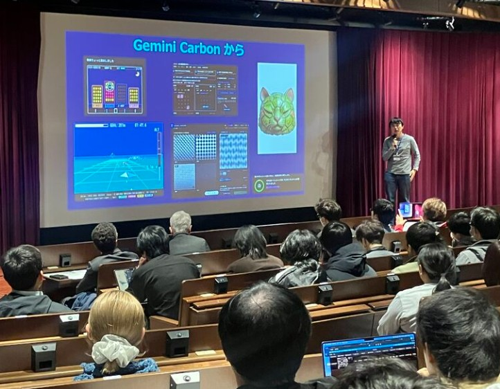
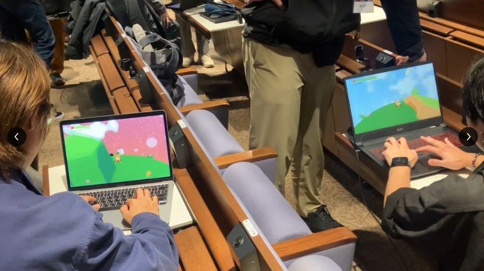
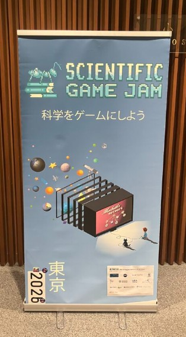

So much talent and creativity at the [Scientific Game Jam 2026](https://jp-minerals.org/scientificgamejam/jp/) hosted at The University of Tokyo! Great to see researchers, students and game developers teaming up to turn science into games. Thanks to the organizers and supporters including Google DeepMind.

